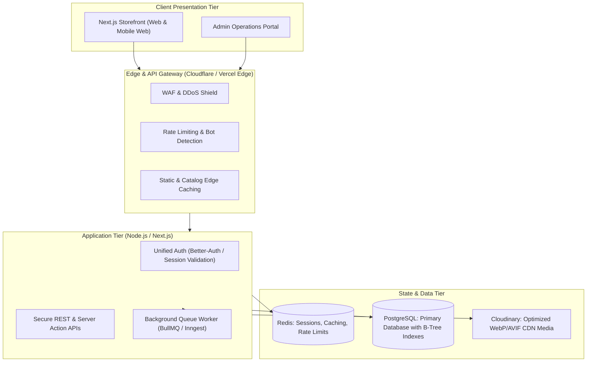

# ARCHITECTURE & IMPROVEMENT ROADMAP
## Enterprise Modernization, Security Hardening & Scalability Blueprint

**Date:** November 5, 2026  
**Target:** Moodest E-Commerce Platform  
**Horizon:** 4-Phase Transformation to Enterprise-Grade Production  

---

## 1. Current Architecture vs. Target Enterprise Architecture

### Current State
* Split monolithic codebase with disconnected Next.js 14 frontend and Next.js 15 backend.
* Frontend expecting a NestJS microservice at `localhost:4000` with JWTs; backend implementing Better-Auth cookie sessions on `localhost:3000`.
* Missing database indexes, missing atomic transactions on order processing, and zero automated tests.
* Unauthenticated endpoints exposing critical business logic and customer PII.

### Target Architecture

---

## 2. Prioritized Implementation Plan

### Phase 1: Immediate Security & Financial Lockdown (P0)
**Objective:** Eliminate severe financial loss vulnerabilities, unauthorized data access, and PII exposure.

| Priority | Task Description | Target File(s) | Complexity |
| :---: | :--- | :--- | :---: |
| **P0** | **Fix Razorpay Payment Verification:** Calculate order amounts on server from DB; verify captured amount via `razorpay.payments.fetch(paymentId)`. | `backend/src/app/api/payment/*` | **Medium** |
| **P0** | **Secure Order Status Endpoint:** Add `await getAuthenticatedAdmin()` guard to `/api/admin-orders/[id]/status`. | `backend/src/app/api/admin-orders/[id]/status/route.ts` | **Small** |
| **P0** | **Secure Inventory Mutations:** Add admin guard to `/api/inventory/[id]` PATCH endpoint. | `backend/src/app/api/inventory/[id]/route.ts` | **Small** |
| **P0** | **Secure Product Creation Endpoints:** Guard `/api/product/withvariant` and `/api/product/edit-with-variant` with admin authentication. | `backend/src/app/api/product/*` | **Small** |
| **P0** | **Eliminate Invoice IDOR:** Restrict `/api/orders/[id]/invoice` to verified order owner or admin. | `backend/src/app/api/orders/[id]/invoice/route.ts` | **Small** |
| **P0** | **Credential Rotation:** Rotate exposed Razorpay, MongoDB, Cloudinary, and Gmail credentials; move secrets to environment managers. | `.env`, `.env.local` | **Small** |

---

### Phase 2: Frontend-Backend Unification & Contract Alignment (P1)
**Objective:** Restore live client-server communication and eliminate dead code.

| Priority | Task Description | Target File(s) | Complexity |
| :---: | :--- | :--- | :---: |
| **P1** | **Unify Authentication Protocol:** Refactor `MOODEST/context/AuthContext.tsx` and `lib/apiFetch.ts` to use Better-Auth cookie credentials (`credentials: "include"`) instead of dead JWT `localStorage` tokens. | `MOODEST/lib/apiFetch.ts`, `MOODEST/context/AuthContext.tsx` | **Medium** |
| **P1** | **Align REST Endpoints & Data Models:** Map `MOODEST/lib/api.ts` to backend routes (`/api/product`, `/api/orders`, `/api/user-profile`). | `MOODEST/lib/api.ts` | **Medium** |
| **P1** | **Prisma Transaction Wrapping:** Wrap checkout and order creation inside `prisma.$transaction` with inventory checks to prevent overselling. | `backend/src/app/api/orders/route.ts`, `backend/src/app/api/payment/verify/route.ts` | **Medium** |
| **P1** | **Webhook Handler for Razorpay:** Implement `/api/payment/webhook` with HMAC signature validation to process orders even if users close browsers before redirect. | `backend/src/app/api/payment/webhook/route.ts` | **Medium** |

---

### Phase 3: Data Engineering, Indexing & Caching (P2)
**Objective:** Optimize database queries and introduce low-latency caching.

| Priority | Task Description | Target File(s) | Complexity |
| :---: | :--- | :--- | :---: |
| **P2** | **Prisma Database Indexing:** Add composite and B-tree indexes (`@@index`) for categories, brands, dates, and order statuses. | `backend/prisma/schema.prisma` | **Small** |
| **P2** | **Fix Cart N+1 Query Loop:** Replace individual variant lookups with a single batch `in: variantIds` query. | `backend/src/app/api/cart/route.ts` | **Small** |
| **P2** | **Integrate Redis / Upstash:** Cache product catalog, category trees, and homepage banners with automated invalidation on mutation. | `backend/src/lib/redis.ts` | **Medium** |
| **P2** | **Add HTTP Security Headers:** Configure CSP, HSTS, X-Frame-Options, and CORS in Next.js middleware. | `backend/src/middleware.ts` | **Small** |

---

### Phase 4: Observability, Background Jobs & Testing (P3)
**Objective:** Establish enterprise monitoring, asynchronous background task processing, and regression protection.

| Priority | Task Description | Target File(s) | Complexity |
| :---: | :--- | :--- | :---: |
| **P3** | **Structured Logging & Error Tracking:** Install Sentry and Pino for centralized exception capture and request tracing. | `backend/src/lib/logger.ts` | **Medium** |
| **P3** | **Background Worker Queue:** Offload PDF invoice generation and email dispatch to a BullMQ worker queue. | `backend/src/lib/queue.ts` | **Large** |
| **P3** | **Automated Test Suite:** Implement Vitest unit tests for order utilities and Playwright E2E tests for the checkout flow. | `backend/tests/`, `MOODEST/tests/` | **Large** |
| **P3** | **Cloudinary Direct Upload:** Replace server-side Base64 upload with pre-signed client uploads directly to Cloudinary. | `backend/src/lib/upload.ts` | **Medium** |

