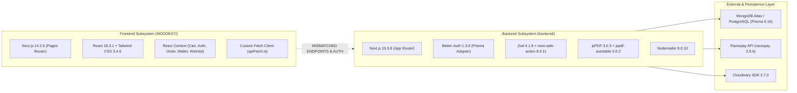

# COMPLETE REPOSITORY AUDIT: MOODEST / DECOMOJA
## Enterprise Full-Stack Architecture, Code Quality & Production Readiness Report

**Date:** November 5, 2026  
**Repository Path:** `F:\Moodest`  
**Assessment Mode:** READ-ONLY Deep Architectural Audit  
**Audited Subsystems:** `backend/` (Next.js 15 Backend API) and `MOODEST/` (Next.js 14 Frontend Client)  

---

## 1. Executive Summary & Production Readiness Score

| Metric | Score | Status | Key Justification |
| :--- | :---: | :---: | :--- |
| **Architectural Cohesion** | **20 / 100** | 🔴 Critical Disconnect | Frontend client is hardcoded to call a non-existent NestJS API (`localhost:4000`) with JWTs, while the backend is Next.js 15 with Better-Auth session cookies. Silent mock fallback hides this. |
| **Security & Hardening** | **25 / 100** | 🔴 Severe Vulnerabilities | Unauthenticated order status changes, unauthenticated stock mutation, unauthenticated product upload, payment amount tampering, public IDOR on PDF invoices. |
| **Data Engineering** | **40 / 100** | 🟠 Suboptimal | Zero database indexes (`@@index`) in Prisma schema; order creation and stock decrements execute outside transactions (`$transaction`). |
| **Performance & Caching**| **30 / 100** | 🟠 Needs Infrastructure | Zero Redis caching, zero HTTP `Cache-Control` headers, N+1 query loop on cart load, in-memory Base64 image uploads. |
| **Testing & Observability**| **05 / 100** | 🔴 Non-Existent | Zero unit, integration, or E2E tests (`0 test files`). No structured logging (Pino/Winston), no Sentry error tracking, no audit logs. |
| **OVERALL ENTERPRISE READINESS** | **24 / 100** | 🔴 **NOT PRODUCTION READY** | High risk of financial loss (payment tampering), data breaches (PII invoice leak), and broken client-server binding. |

---

## 2. Technology Stack Discovery



### Detailed Subsystem Breakdown

#### Frontend (`MOODEST/`)
* **Framework:** Next.js `14.2.5` using the legacy **Pages Router** (`pages/` directory: `_app.tsx`, `index.tsx`, `checkout.tsx`, etc.).
* **UI & Styling:** React `18.3.1`, Tailwind CSS `3.4.6`, Autoprefixer `10.4.19`, PostCSS `8.4.39`.
* **State Management:** Multiple React Context providers (`AuthContext`, `CartContext`, `WishlistContext`, `OrderContext`, `AddressContext`, `WalletContext`, `NotificationContext`, `SearchContext`).
* **Client HTTP Transport:** `lib/apiFetch.ts` and `lib/api.ts` hardcoded to look for a NestJS-style backend at `http://localhost:4000` with JWT Bearer tokens in `localStorage`.

#### Backend (`backend/`)
* **Framework:** Next.js `15.5.9` using the modern **App Router** (`src/app/api/*`).
* **Language & Runtime:** TypeScript `5.x`, Node.js `20.x` engine.
* **Database & ORM:** Prisma ORM `6.16.1` with `@prisma/client 6.10.1`.
* **Authentication Provider:** Better-Auth `1.3.9` with session cookies and Prisma adapter.
* **Validation Layer:** Zod `4.1.8`, `zod-form-data 3.0.1`, `next-safe-action 8.0.11`.
* **Media & Documents:** Cloudinary `2.7.0`, jsPDF `3.0.3`, `jspdf-autotable 5.0.2`.
* **Communications:** Nodemailer `8.0.10` with Gmail SMTP.

---

## 3. Critical Architectural Flaw: The NestJS / Next.js Disconnect

The most significant structural defect in this repository is that **the frontend and backend are completely decoupled and incompatible out-of-the-box**:

1. **Origin & Port Disconnect:**
   * Frontend `MOODEST/lib/apiFetch.ts` (lines 17–20) defines default backend origin as `http://localhost:4000`.
   * Backend `backend/` runs by default as a Next.js server on `http://localhost:3000`.

2. **Authentication Protocol Mismatch:**
   * Frontend `MOODEST/lib/apiFetch.ts` expects JWT access and refresh tokens (`moryelle_access_token_v1`, `moryelle_refresh_token_v1`) stored in `localStorage` and sent via `Authorization: Bearer <token>` headers.
   * Backend `backend/src/lib/auth.ts` implements **Better-Auth** which uses HTTP-only cookie-based sessions (`better-auth.session_token`).

3. **API Endpoint Divergence:**
   * Frontend calls `POST /api/auth/login` expecting `{ access_token, refresh_token }`.
   * Frontend calls `POST /api/auth/register` (Backend only exposes Better-Auth `/api/auth/sign-up/email` or `/api/auth/create-user`).
   * Frontend calls `GET /api/users/me` (Backend only exposes `/api/user-profile`).
   * Frontend calls `GET /api/products` (plural) (Backend only exposes `/api/product` singular).

4. **Silent Mock Fallback Masking Failure:**
   * In `MOODEST/lib/hooks.ts` (lines 76–83), when `productAPI.getAll()` fails due to network error or 404, it catches the error and silently populates the UI from `products.json`. This makes the application look functional in UI testing while the backend connection is completely broken.

---

## 4. Module & Code Organization Review

```
Moodest/
├── backend/
│   ├── prisma/
│   │   ├── schema.prisma         # Data models
│   │   └── seed.ts               # Test seed data
│   ├── src/
│   │   ├── app/api/              # 21 REST endpoint handlers
│   │   ├── lib/                  # Auth, Prisma, Cloudinary, Email, PDF singletons
│   │   ├── schema/               # Zod validation schemas
│   │   ├── server/actions/       # Server actions (partially bypassed by REST)
│   │   ├── types/                # TypeScript interface declarations
│   │   └── middleware.ts         # Edge session check
│   ├── .env                      # Contains live production credentials
│   └── package.json
└── MOODEST/
    ├── components/               # React presentational and layout components
    ├── context/                  # 9 React context state providers
    ├── data/                     # Local JSON mock fallback data
    ├── lib/                      # apiFetch transport and service definitions
    ├── pages/                    # Next.js Pages router views
    └── .env.local                # Contains live Vercel OIDC token
```

### Strengths
- Good schema separation in `backend/src/schema/` using Zod.
- High-fidelity PDF invoice generator (`backend/src/lib/invoice-generator.ts`) with tabular breakdowns and rupee currency formatting.
- Clean visual UI styling with Tailwind CSS on the storefront.
- Well-structured Prisma relational model for multi-attribute products (`Attribute`, `AttributeValue`, `VariantOption`, `ProductVariant`).

### Weaknesses & Code Smells
- **Dual API Architecture:** The backend duplicates logic between `src/app/api/*` route handlers and `src/server/actions/*`. Route handlers frequently bypass the safe action validation and call Prisma directly without permission checks.
- **Dead & Non-Existent Functionality:** Frontend UI contains full pages and context for `wallet.tsx` and coupon validation, but the backend has zero wallet tables, zero coupon tables, and zero wallet endpoints.
- **Missing Build & Test Scripts:** `backend/package.json` contains no `test`, `lint`, or `build` npm scripts.

