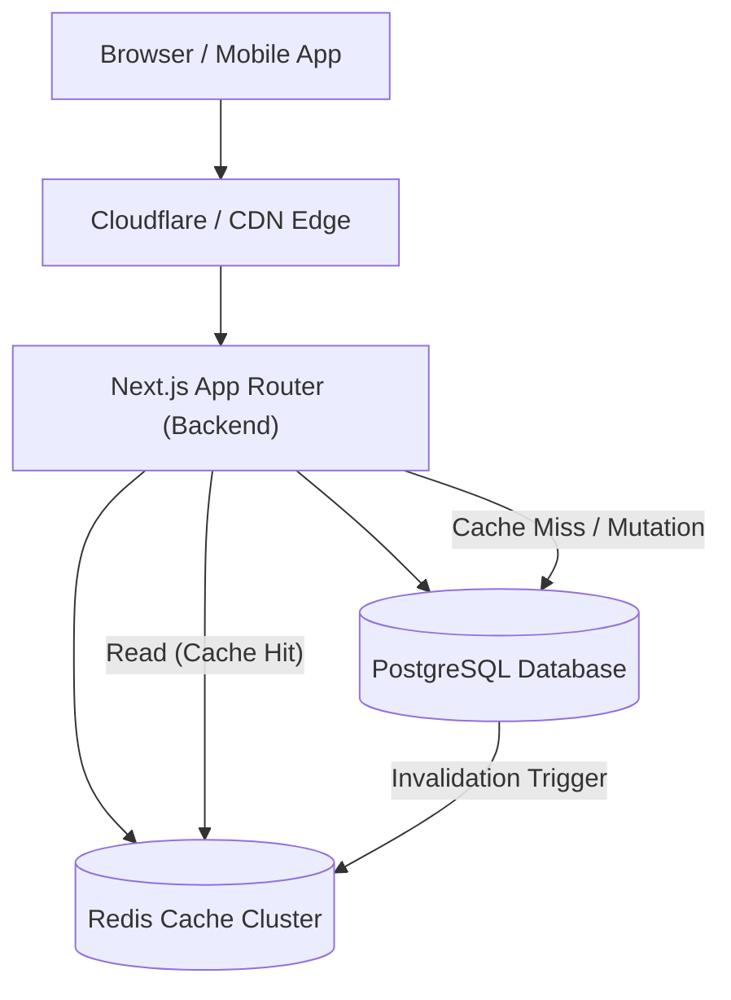

# ENTERPRISE PERFORMANCE & CACHING AUDIT
## Database Optimization, Caching Topologies & Latency Profiling

**Date:** November 5, 2026  
**Repository:** `F:\Moodest`  
**Scope:** Database (Prisma), Backend API (Next.js 15), Frontend Client (Next.js 14)  

---

## 1. Database Performance & Schema Bottlenecks

### Missing Database Indexes (Full Table / Collection Scans)
In `backend/prisma/schema.prisma`, **there are zero `@@index` annotations defined across the entire data model**.

Every filter, foreign key join, and sorting operation currently triggers an unindexed sequential scan:

| Model | Unindexed Field | Query Location | Performance Impact at Scale (10k+ rows) |
| :--- | :--- | :--- | :--- |
| `Product` | `categoryId` | `/api/product?categoryId=...` | High latency on category browsing |
| `Product` | `brandId` | `/api/product?brandId=...` | High latency on brand filtering |
| `Product` | `createdAt` | `/api/latest-products` | Full scan sorting on every page view |
| `ProductVariant` | `productId` | Cascade lookups, `/api/product` joins | Slow cart, order & catalog assembly |
| `ProductVariant` | `price`, `offerPrice` | Price sorting in `/api/product` | Unindexed in-memory sort |
| `Order` | `userId` | `/api/orders` | Customer order history scan |
| `Order` | `createdAt`, `status` | `admin-report-actions.ts` | Complete analytics dashboard stall |
| `Address` | `userId` | `/api/addresses` | Sequential scan per user address lookup |
| `Review` | `productId` | `/api/reviews` | Slow product detail page loading |

#### Recommended Indexing Patch
```prisma
model Product {
  // ... fields
  @@index([categoryId])
  @@index([brandId])
  @@index([createdAt(sort: Desc)])
  @@index([isCustomerFavorite, isNewArrival])
  @@map("product")
}

model ProductVariant {
  // ... fields
  @@index([productId])
  @@index([price])
  @@map("product_variant")
}

model Order {
  // ... fields
  @@index([userId])
  @@index([createdAt(sort: Desc)])
  @@index([status])
  @@map("order")
}
```

---

### N+1 Query Anti-Pattern in Cart Management
* **Location:** `backend/src/app/api/cart/route.ts` (lines 28–41)
* **Code Issue:**
  ```typescript
  const itemsToCheck = cart.items;
  for (const item of itemsToCheck) {
    const variantExists = await prisma.productVariant.findUnique({
      where: { id: item.variantId },
    });
    if (!variantExists) {
      await prisma.cartItem.delete({
        where: { id: item.id },
      });
    }
  }
  ```
* **Performance Impact:**
  If a customer has 10 items in their cart, fetching the cart triggers **1 initial query + 10 individual variant lookups + up to 10 individual delete queries + 1 final cart fetch** ($1 + 2N$ queries).
* **Fix:**
  Replace with relational integrity (`onDelete: Cascade` in schema) or a single set operation:
  ```typescript
  const existingVariantIds = (await prisma.productVariant.findMany({
    where: { id: { in: cart.items.map(i => i.variantId) } },
    select: { id: true },
  })).map(v => v.id);

  await prisma.cartItem.deleteMany({
    where: {
      cartId: cart.id,
      variantId: { notIn: existingVariantIds },
    },
  });
  ```

---

## 2. Caching Architecture Assessment

| Caching Layer | Implemented State | Enterprise Requirement | Gap Analysis |
| :--- | :---: | :---: | :--- |
| **Distributed Cache (Redis)** | ❌ None | Redis Cluster / Upstash | Sessions, product caches, and cart states hit DB on every request. |
| **HTTP Response Headers** | ❌ None | `Cache-Control: s-maxage=300, stale-while-revalidate=600` | Zero caching headers; CDN is bypassed for all API responses. |
| **Edge / CDN Caching** | ⚠️ Partial | Cloudflare / Vercel Edge Cache | Assets on Cloudinary have CDN caching; backend API endpoints have none. |
| **Database Query Caching** | ❌ None | Prisma Accelerate or Redis cache | Aggregation reports recalculate total revenue on every admin load. |

---

## 3. Recommended Enterprise Caching Strategy



### Proposed Cache Keys, TTL & Invalidation Rules

| Cache Scope | Key Pattern | TTL | Invalidation Trigger |
| :--- | :--- | :---: | :--- |
| **Public Product Details** | `catalog:product:{id}` | 1 hour | Admin update product, variant stockout |
| **Category Listing** | `catalog:category:{slug}:page:{n}` | 2 hours | Category mutation or product reassignment |
| **Homepage Banners** | `marketing:banners` | 24 hours | Admin banner reorder or image upload |
| **User Session** | `session:{token}` | 7 days | Logout, password change, account ban |
| **Customer Cart** | `cart:user:{userId}` | 30 days | Cart add, remove, checkout completion |
| **Admin Analytics Metrics** | `analytics:sales:{dateRange}` | 15 mins | New order placement, order cancellation |

---

## 4. Frontend & Media Bottlenecks

1. **In-Memory Base64 Expansion:**
   In `backend/src/lib/upload.ts`, image files are converted into base64 strings in Node.js RAM before being sent to Cloudinary. Base64 encoding inflates memory consumption by ~33%. Under concurrent uploads, this creates memory spikes and garbage collection pauses.
   * **Recommendation:** Use direct client-to-Cloudinary signed uploads using `@cloudinary/url-gen` or stream streams directly.

2. **Silent Retries in Frontend Hooks:**
   In `MOODEST/lib/hooks.ts`, `useProducts` catches API failures and falls back to static JSON. Because the hook re-runs on parameter updates, this triggers unnecessary network roundtrips to an unaligned endpoint on every route navigation.

